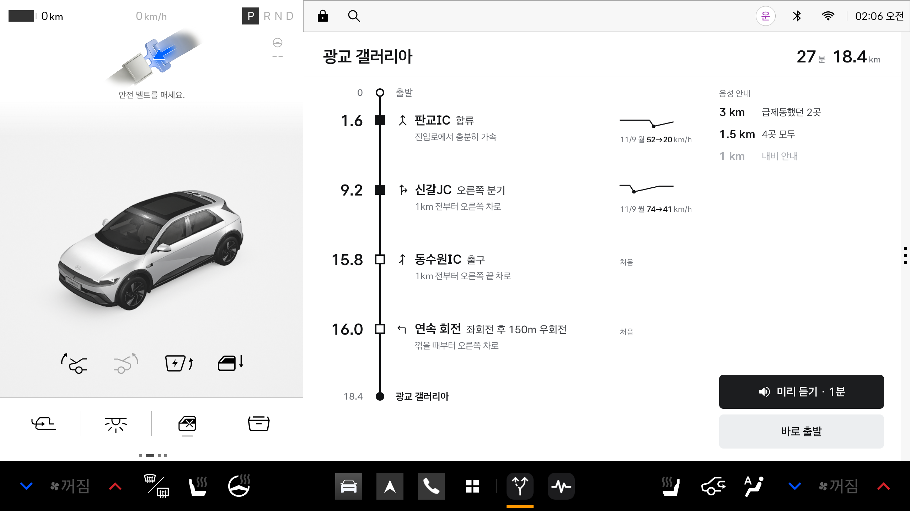
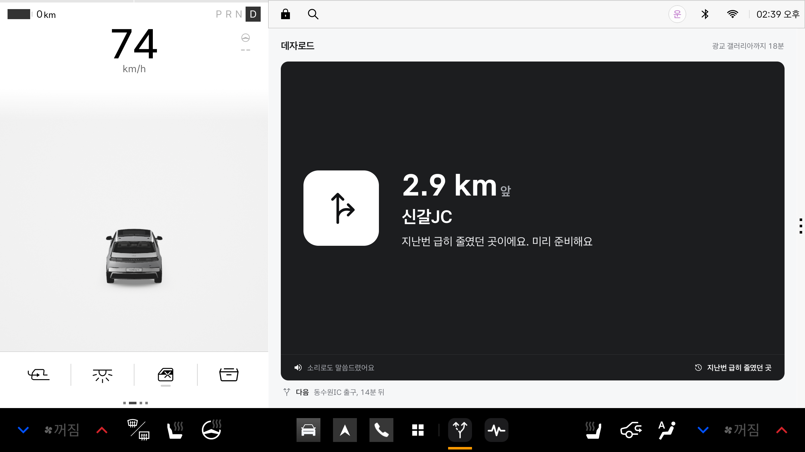
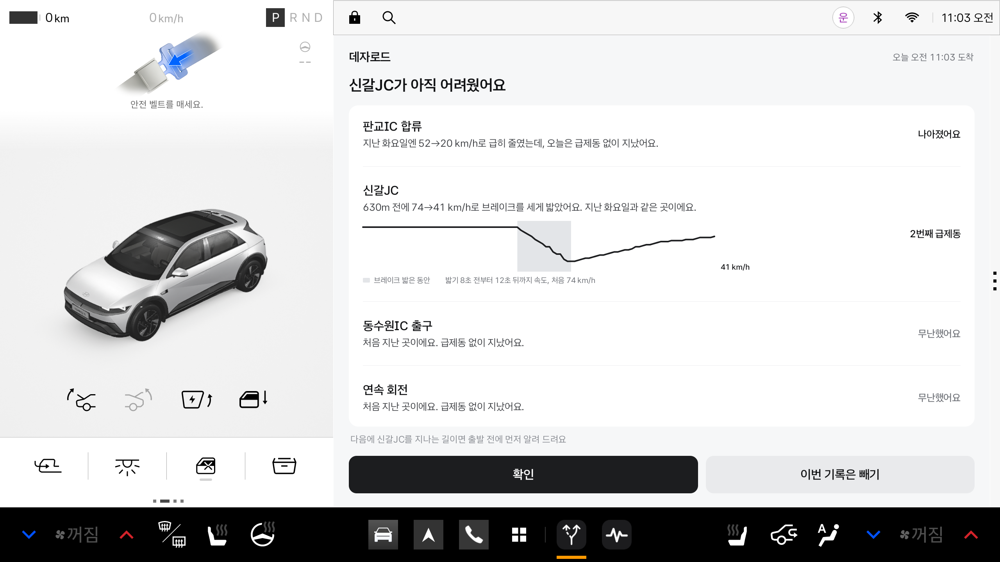

# 데자로드 (Déjà Road)

**처음 가는 길의 합류·분기 지점을 출발 전에 미리 듣고, 내가 급제동한 곳을 다음에 먼저 알려 주는 Pleos Connect 차량용 앱**

출발 전(정차 중)에는 오늘 경로에서 고속도로 합류, 분기점(JC), 출구, 회전교차로, 연속 회전 같은 지점만 골라 노선도처럼 보여 주고 1분 안에 소리로 읽어 줍니다. 주행 중에는 내비의 1km 안내보다 먼저, 각 지점 1.5km 앞에서 할 일을 알려 줍니다. 지난번에 급제동한 곳은 3km 앞에서 한 번 더 알려 줍니다. 도착하면 지점마다 오늘 속도와 지난번 속도를 같은 자리끼리 겹쳐 보여 주고, 급제동한 곳을 기억해 두었다가 다음 예습에 넣습니다.

| 출발 전 예습 | 주행 중 안내 | 도착 후 복습 |
|---|---|---|
|  |  |  |

## APK

- 위치: [`apk/`](apk/) 폴더의 `팀명_DejaRoad_release.apk`
- 패키지 이름: `com.dejaroad.app`, 버전 0.1.0 (versionCode 1)

## 실행 방법

### APK로 바로 실행

Pleos Connect 에뮬레이터를 켠 뒤:

```bash
adb install -r -g --user 10 apk/팀명_DejaRoad_release.apk
adb shell am start --user 10 -n com.dejaroad.app/.MainActivity
```

- 처음 실행할 때 위치, 차량 속도, 알림 권한을 묻습니다. 모두 허용해 주세요. 위 `-g` 옵션으로 설치하면 미리 허용됩니다.
- Pleos 에뮬레이터 앱은 사용자 10으로 실행되므로 `--user 10`을 붙입니다.

### 소스에서 빌드

```bash
./gradlew :app:assembleDebug
adb install -r -g --user 10 app/build/outputs/apk/debug/app-debug.apk
```

release APK는 서명 키가 있어야 합니다. 프로젝트 루트에 `keystore.properties`를 만들고(`keystore.properties.example` 참고) 아래 명령을 실행하면 `apk/팀명_DejaRoad_release.apk`로 복사됩니다.

```bash
./gradlew :app:exportReleaseApk -PteamName=팀명
```

### 시연 순서 (에뮬레이터)

에뮬레이터 내비가 경로를 주지 못할 때(아래 '알려진 문제')를 위해, 내비 회전 안내와 같은 형식의 시연 경로(판교역 → 광교 갤러리아, 18.4km)를 넣는 명령이 있습니다.

```bash
# 1) 시연 경로 넣기 (+ 지난번 급제동 기록 넣기)
adb shell am start --user 10 --activity-single-top -n com.dejaroad.app/.MainActivity --ez demo_steps true --ez seed_past true

# 2) 주행 재생: Virtual Console로 속도·브레이크를 보내며 약 4분간 달린다 (화면 캡처 폴더는 선택)
adb forward tcp:8088 tcp:8088
python tools/demo_drive.py <adb 경로> emulator-5554 [캡처 폴더]
```

| 명령 (`--ez 이름 true`) | 하는 일 |
|---|---|
| `demo_steps` | 시연용 회전 안내 목록을 넣는다 |
| `demo_route` | 실제 내비에 광교 갤러리아 경로를 요청한다 |
| `seed_past` | 판교IC·신갈JC에 지난번 급제동 기록을 넣는다 (시연용) |
| `clear` | 기억한 기록을 모두 지운다 |
| `play` | 예습을 소리로 읽는다 |
| `end` | 주행을 끝내고 복습을 보인다 |
| `--ef jump 7600` | 경로 위 위치를 7,600m로 옮긴다 |

## 테스트 환경 및 필요한 설정

| 항목 | 값 |
|---|---|
| Pleos Connect 에뮬레이터 | 시스템 이미지 `Pleos_Connect_v2.1.0` (`RELEASE.release_connect_v2.1.0`, Android 14 / API 34, x86_64) |
| Android Emulator | 37.3.9.0 (build 16863232) |
| 화면 규격 | 2560 × 1440, 160 dpi (1dp = 1px). 앱 창은 넓은 창(가로)과 Pleos 기본 배치인 내비 옆 절반 창(세로, 약 841 × 1210dp) 모두 확인 |
| 개발 도구 | Android Studio (JDK 17 이상), Gradle 9.1, Android Gradle Plugin 9.0.1, Kotlin 2.3.20, Jetpack Compose |
| SDK | minSdk 28, targetSdk 36, compileSdk 36 |
| 시연 주행 | Pleos Virtual Console(에뮬레이터 안 127.0.0.1:8088), Python 3 |

- Pleos Connect SDK는 `https://nexus-playground.pleos.ai/repository/maven-releases/`에서 받습니다(`settings.gradle.kts`). 별도 API 키는 필요 없습니다.
- 앱이 쓰는 권한: `CAR_DRIVE`, `CAR_SPEED`, `NAVI_ROUTE`, `NAVI_ROUTE_SEARCH`, `FUSED_LOCATION`, `TTS_SERVICE`, 위치, 포그라운드 서비스(위치), 알림.
- 길 기억(급제동 기록)은 앱 안의 JSON 파일에만 저장하고 서버로 보내지 않습니다.

## 사용한 Pleos Connect SDK

| SDK (버전) | 쓰는 곳 |
|---|---|
| NaviHelper 3.0.5 | 회전 안내 목록(onTBTInfo), 목적지·남은 거리·시간, 경로 시작·끝·취소, 도착, 경로 요청 → 지점 고르기와 '몇 분 뒤' 계산 |
| Vehicle 2.3.2 | 브레이크 페달, 기어(P/D) → 급제동 찾기, 예습(정차)·안내(주행) 나누기 |
| TextToSpeech 3.3.1 | 출발 전 예습 읽기, 3km·1.5km 앞 안내 |
| FusedLocation 1.1.3 | 급제동 위치 기록 |
| AAOS Car API | 차 속도(`PERF_VEHICLE_SPEED`) → 달린 거리, 급제동 판정 |

SpeechToText 3.3.1은 의존성에만 들어 있고 아직 쓰지 않습니다.

## 구조

```
app/src/main/java/com/dejaroad/app/
  RoadSession.kt   앱의 중심: 경로 → 지점, 주행 중 안내, 주행 끝 → 복습
  Route.kt         내비 회전 안내 목록에서 지점 고르기 (합류·분기·출구·회전교차로·연속 회전 등)
  HardBrake.kt     급제동 찾기 (브레이크를 밟은 동안 35km/h 이상에서 20km/h 넘게, 초당 7km/h 넘게 감속)
  Review.kt        지점마다 급제동 / 나아짐 / 무난
  Profile.kt       지점 800m 전 ~ 150m 뒤 속도를 거리 기준으로 (지난번과 겹쳐 보기)
  Memory.kt        길 기억 저장 (JSON)
  Script.kt        화면 문구와 음성 문장
  NaviWatcher.kt, VehicleFeed.kt, VoiceGuide.kt, LocationTracker.kt   Pleos SDK 연결
  RoadService.kt   앱 창이 가려져도 동작하는 포그라운드 서비스
  ui/              예습(노선도), 주행(안내판), 복습 화면
app/src/test/      단위 테스트 13개 (급제동 판정, 지점 고르기, 복습, 문구)
tools/demo_drive.py  시연 주행 재생
captures/          에뮬레이터 화면
```

단위 테스트: `./gradlew :app:testDebugUnitTest`

## 알려진 문제

- **에뮬레이터 내비가 경로를 주지 못합니다(2026-11-12 확인).** 에뮬레이터 속 내비 앱이 지도 인증 응답을 읽다가 `Encountered an unknown key 'profile'` 오류로 지도를 초기화하지 못해, '내비게이션 실행이 지연되고 있습니다'에서 멈춥니다. 그래서 화면과 동작은 내비 회전 안내와 같은 형식의 시연 경로(`demo_steps`)로 확인했습니다. 실제 내비 연결 코드(NaviHelper 회전 안내·목적지·경로 요청)는 들어 있고, 경로 요청이 내비까지 전달되는 것은 로그로 확인했습니다.
- 내비가 스스로 1km 앞에서 안내한다는 것은 국내 내비의 일반적인 기준이며, 이 에뮬레이터 내비로는 확인하지 못했습니다.
- 내비가 차로 수를 주지 않으므로 차로 그림 대신 길 모양 아이콘만 보여 줍니다.

## 라이선스 고지

- 글꼴: Asta Sans (42dot, SIL Open Font License 1.1) — `licenses/AstaSans-OFL.txt`
- 아이콘: Material Symbols Rounded (Google, Apache License 2.0) — `licenses/MaterialSymbols-Apache-2.0.txt`
